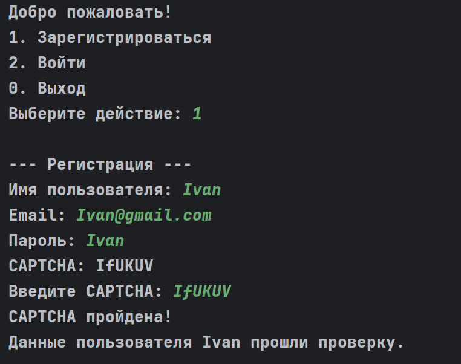
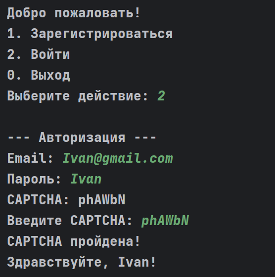

# Система аутентификации

Программа реализует регистрацию и авторизацию пользователей:

- **Регистрация** — создание пользователя по email, логину и паролю.
- **Авторизация** — вход по email и паролю.
- **Защита паролей** — хеширование с помощью Argon2.
- **CAPTCHA** — проверка пользователя при регистрации и входе.

Данные пользователей сохраняются в базе данных SQLite `auth.db`.

## Примеры

### Регистрация



### Авторизация



**Запуск:**

```bash
python main.py
```

## CI/CD-конвейер

Для проекта настроен GitHub Actions workflow
`.github/workflows/ci.yml`. Он запускается при push в ветки `master`,
при создании pull request, а также вручную из вкладки **Actions**.

Конвейер состоит из трёх этапов:

1. **Lint and test** — устанавливает приложение, проверяет код с помощью Ruff,
   проверяет синтаксис Python и запускает тесты CAPTCHA и хеширования
   паролей.
2. **Package application** — после успешных проверок создаёт архив
   `auth-system.zip` и публикует его как артефакт сборки.
3. **Build report** — всегда формирует итоговую таблицу в GitHub Actions Summary
   и создаёт уведомление об успешном или неуспешном результате.
